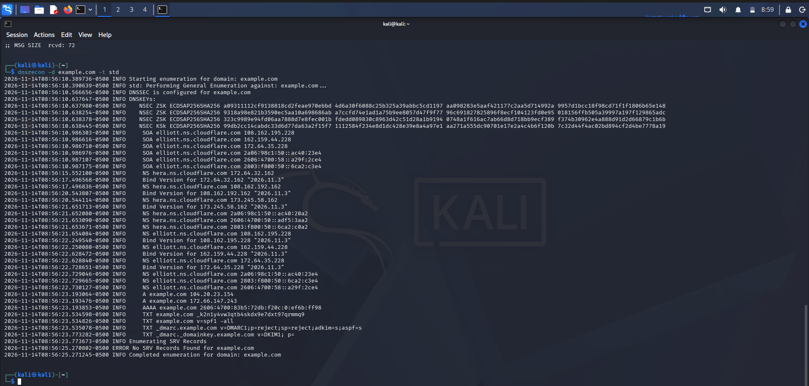
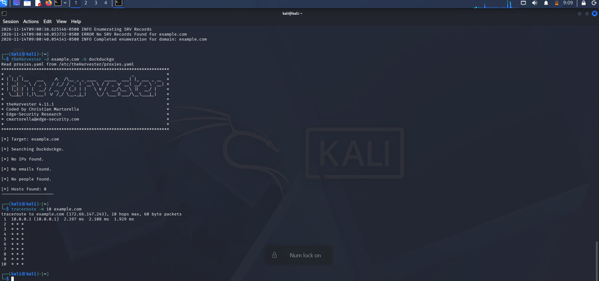
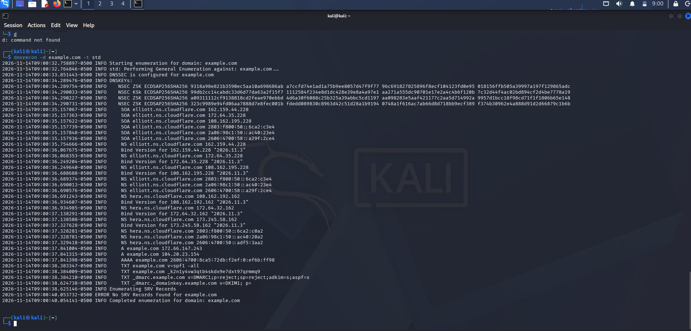
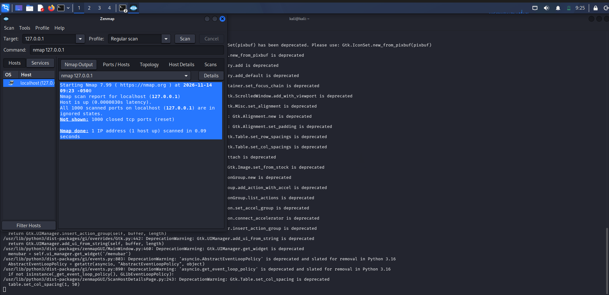
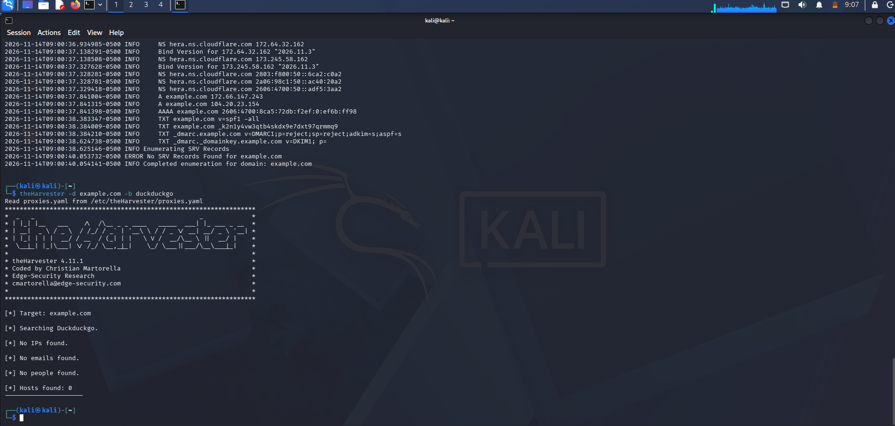
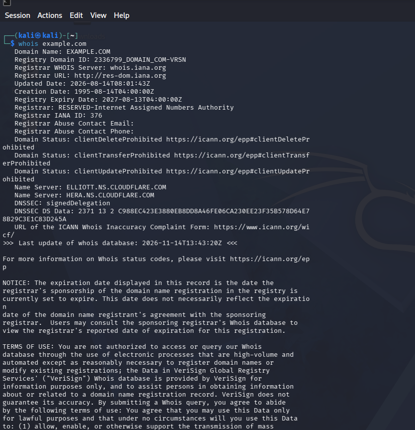
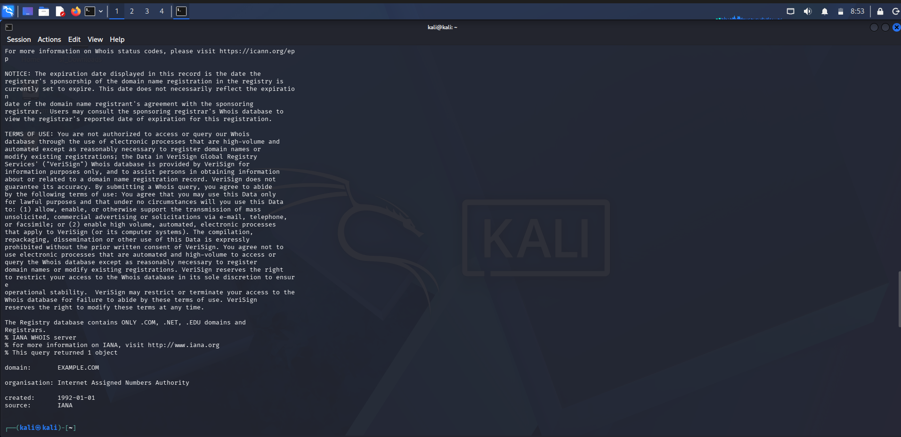
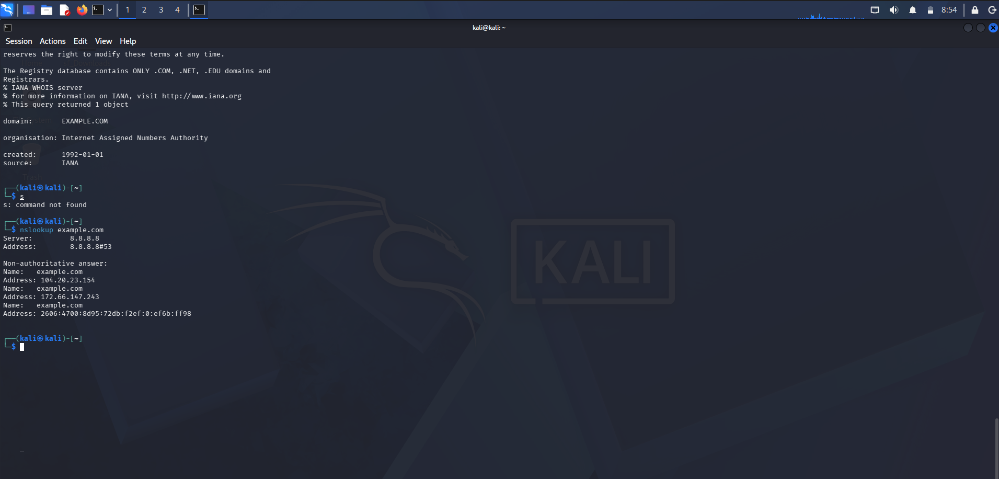
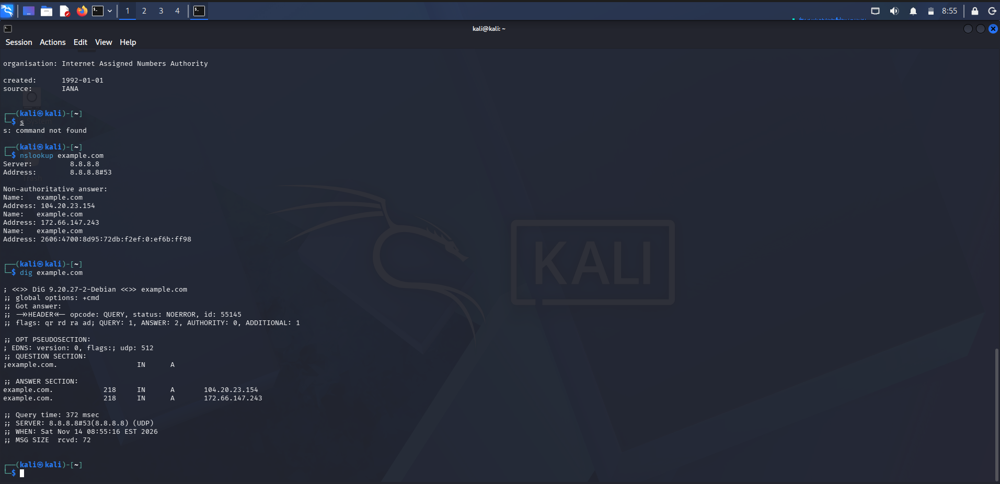

# Week 2 - Cybersecurity Project

A project undertaken through learning of practical cybersecurity knowledge through using Kali Linux in Oracle VM VirtualBox as per my NetworkWalks Academy training.

## Project Modules

### 1. Footprinting using Kali Linux Tools (PM1)

Tools Used:

- WHOIS
- NSLookup
- DIG
- DNSRecon
- theHarvester
- Traceroute

Practice domain: `example.com`

### 2. Network Scanning using Zenmap (PM5)

- Tool: Zenmap (Nmap GUI)
- Target: `127.0.0.1` (my own Kali Linux VM)
- Profile Used: Regular scan
- Result: Up host; All 1000 TCP ports closed.

## Laboratory Environment

- Operating system used: Kali Linux
- Virtualization platform used: Oracle VM VirtualBox
- Host operating system: Windows
- Platform used: NetworkWalks Academy

## Screen Shots

         
Screenshots of the practicals have been attached to this repository.

## Learning outcomes

- Domain and DNS knowledge.
- Practice of footprinting tools.
- Practice of DNS Enumeration.
- Network Route Observations.
- Practice of a local network scan with Zenmap.
- Basic understanding of scan results.

## Note

Footprinting commands mentioned here were practiced against the `example.com` while the Zenmap scan was conducted on my own Kali Linux VM.

This lab assignment was done for educational purposes only.